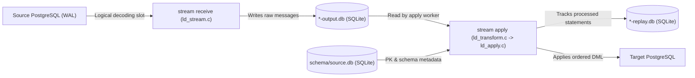

# Streaming COPY and CDC Architecture

`pgcopydb` removes the two core serialization bottlenecks of standard `pg_dump | pg_restore` pipelines while keeping schema fidelity and crash resumability.

## Direct Streaming and Lock-Minimized Index Creation

Traditional `pg_dump --jobs` directory exports write table rows to local disk before `pg_restore --jobs` reads them back. `pgcopydb` keeps `pg_dump` and `pg_restore` strictly for pre-data and post-data DDL, while a supervisor forks parallel libpq `COPY` workers that stream rows directly from source to target inside a shared exported snapshot.

For constraints, `pg_restore` executes `ALTER TABLE ... ADD CONSTRAINT`, which holds long `ACCESS EXCLUSIVE` locks sequentially. `pgcopydb` builds all `UNIQUE` and secondary indexes concurrently via dedicated index workers and then binds constraints instantaneously using `ALTER TABLE ... ADD CONSTRAINT ... USING INDEX`.

## Two-Process SQLite CDC Pipeline

Online migrations (`pgcopydb clone --follow`) coordinate base copy and logical replication side-by-side:

Separating WAL consumption (`stream receive`) from inline SQL transformation and execution (`stream apply`) decouples network reads from target write latency. Persisting raw WAL events and replay metadata in SQLite enables safe checkpoint recovery (`--resume`) and space reclamation (`pgcopydb stream prune`) without flat JSON/SQL scratch files.

## Related Documentation

- Upstream design essays: [docs/concurrency.rst](../../concurrency.rst) and [docs/logical-decoding.rst](../../logical-decoding.rst)
- CLI options and SQLite file layout: [CLI Commands and Environment Variables](../03-reference/01-cli-commands-and-env-vars.md)
